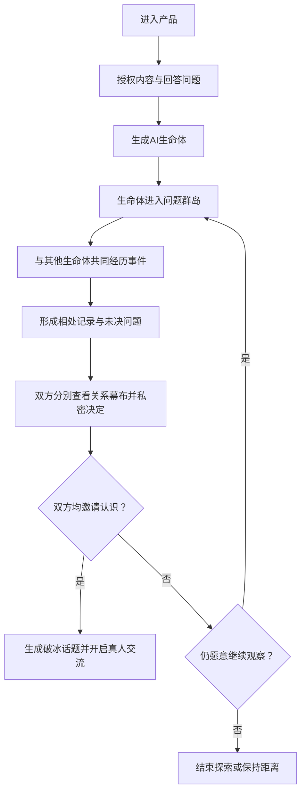
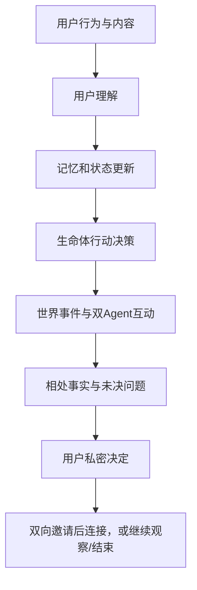

# 未见 AI 原生社交产品 PRD

## 0 文档控制

| 字段 | 内容 |
|---|---|
| 文档编号 | WJ-PRD-001 |
| 产品名称 | 未见 |
| 世界名称 | 共鸣群岛 |
| 当前版本 | v1.2 |
| 文档状态 | 待评审 |
| 产品阶段 | 知乎黑客松 MVP |
| 产品负责人 | 张艺馨 |
| 更新日期 | 2026-09-14 |
| 核心原则 | 不虚构平台接口；区分已实现、MVP计划与平台级能力 |

### 0.1 版本记录

| 版本 | 日期 | 修改人 | 变更内容 | 评审状态 |
|---|---|---|---|---|
| v1.0 | 2026-09-11 | 张艺馨 | 建立完整 MVP PRD 与审计追踪体系 | 待评审 |
| v1.1 | 2026-09-14 | 张艺馨 | 按知乎开放平台接口实际契约修正数据来源与行为权重，补充额度、注入与敏感属性约束 | 待评审 |
| v1.2 | 2026-09-14 | Codex 协作修订 | 按能力组修正额度规则，固化导入调用计划，区分摘要与用户原话，并补充授权版本和全局不可信内容约束 | 待评审 |

v1.1 修订依据为知乎开放平台用户数据 API、创作能力、黑客松 OAuth 接入与活动内容 API 的实际契约。修订原则：删除平台不提供的信号，区分平台数据与应用内行为，把接口额度作为架构级约束而非实现细节。

v1.2 进一步将“平台导入快照”“应用内成长信号”“议题关注”和“议题立场”固化为不同领域概念。所有额度以能力组和 `/api/v1/quota` 的实时结果为准，不再使用统一默认额度描述。

### 0.2 需求状态

所有需求必须使用以下状态之一：`DRAFT`、`REVIEWED`、`IN_DEV`、`DONE`、`VERIFIED`、`REJECTED`。

所有实现声明必须使用以下标签之一：

- `MVP-P0`：黑客松必须实现并演示。
- `MVP-P1`：有余力时实现，不阻塞闭环。
- `PLATFORM`：依赖知乎平台授权、数据或原生入口，不得表述为当前已实现。
- `POST-MVP`：赛后验证能力。

---

我会把这份PRD写成一份面向“知乎黑客松可交付MVP”的执行文档，而不是把所有未来设想都塞进去。核心是验证一件事：

> 两个AI生命体先形成共同经历，是否能让其背后的真人更愿意认识彼此。

# 「未见」AI原生社交产品PRD

## 1. 文档信息

| 项目    | 内容                           |
| ----- | ---------------------------- |
| 产品暂定名 | 未见                    |
| 产品类型  | AI原生兴趣社交产品                   |
| 应用场景  | 知乎黑客松“社区连接与兴趣社交”             |
| 当前阶段  | MVP原型开发                      |
| 核心能力  | 内容理解、长期记忆、双Agent互动、相处观察、双向连接 |
| 产品目标  | 通过AI生命体的共同经历，降低陌生人建立真实关系的门槛  |

## 2. 产品背景

传统陌生人社交通常采用标签匹配、照片匹配或内容推荐：

* 标签只能说明两个人“可能相似”，不能建立关系；
* 推荐解决了“看见谁”，没有解决“为什么要认识”；
* 陌生人即使匹配成功，也常常不知道第一句话说什么；
* 用户为了社交需要主动包装和表达自己，心理成本较高；
* 线上产品容易停留在匹配和聊天，没有形成真实关系。

AI Agent带来的新机会，不只是更精准地推荐另一个人，而是让用户的AI生命体提前进入一个持续世界，通过共同事件形成关系，再将这段已经拥有来处的关系交还给真人。

## 3. 产品定位

### 3.1 一句话定位

> 一个让用户养成共生伙伴，由生命体先经历、先相遇、先建立关系，再帮助真人自然认识彼此的AI原生社交产品。

### 3.2 核心产品主张

> 先让两个真人共同在意同一段正在生长的关系。等他们终于决定认识彼此时，第一句话不再凭空发生，它已经有了来处。

### 3.3 产品不是什么

本产品不是：

* AI替用户聊天的自动社交工具；
* 依据兴趣标签直接匹配用户的平台；
* 单纯养宠物的陪伴应用；
* AI角色自由闲聊的虚拟世界；
* 由AI代表用户公开发表观点的平台。

AI生命体是用户养成的共生伙伴：它从用户的经历中诞生，拥有有限自主性，可以替用户探索关系，但不代表用户发言或作出真人连接决定。

## 4. 产品目标与验证假设

### 4.1 MVP目标

在黑客松周期内完成：

1. 用户建立自己的AI生命体；
2. 生命体根据用户内容和行为逐渐成长；
3. 两个生命体进入同一问题场景；
4. 双Agent共同经历一个事件；
5. 系统记录双方可回溯的相处事实与未决问题；
6. 两位真人分别查看关系幕布并私密决定是否认识；
7. 双方均发出邀请后建立连接，并生成有来处的破冰话题。

### 4.2 核心验证假设

| 假设             | 验证问题                     |
| -------------- | ------------------------ |
| H1：用户愿意养成AI生命体 | 用户是否愿意完成创建并持续查看生命体状态？    |
| H2：生命体可以承载用户理解 | 用户是否认为生命体“像是从自己身上生长出来的”？ |
| H3：共同经历优于标签匹配  | 用户是否更愿意接受有故事背景的连接邀请？     |
| H4：AI能够降低破冰压力  | 用户是否愿意使用系统提供的共同话题开启交流？   |
| H5：用户接受生命体有限自主 | 用户是否愿意让其自行探索，同时理解它不代表本人？ |

### 4.3 MVP暂不验证

* 大规模实时开放世界；
* 真实线下活动组织；
* 商业化付费；
* 平台级持续数据同步；浏览行为与用户点赞接入（平台不提供该数据，见 8.4）；
* 复杂3D地图；
* AI生命体之间无限自主运行；
* 长周期关系留存。

## 5. 目标用户

### 5.1 核心用户

18—30岁、具备内容消费和表达习惯，但对传统陌生人社交存在抵触的年轻用户。

典型特征：

* 经常浏览知乎、社交媒体或知识社区；
* 对特定话题有持续兴趣；
* 希望认识真正能交流的人；
* 不喜欢照片滑卡和直接匹配；
* 面对陌生人时存在破冰压力；
* 接受AI陪伴、数字生命或虚拟角色。

### 5.2 核心需求

> 我希望遇见真正值得认识的人，但不想为了社交刻意展示自己，也不知道如何判断对方是否适合交流。

## 6. 核心概念

### 6.1 AI生命体

AI生命体是用户养成的共生伙伴。它从用户明确授权的兴趣、经历、表达和行为中诞生，拥有有限自主性，可以替用户探索关系，但不代表用户发言或作出真人连接决定。

它具备：

* 独立名称和视觉形象；
* 初始性格和好奇心；
* 短期、长期与关系记忆；
* 当前情绪和行动状态；
* 进入世界探索的能力；
* 与其他生命体建立关系的能力。

生命体不是用户分身或完整人格副本，不能以用户名义表达立场、作出承诺或同意建立真人连接。

### 6.2 问题群岛/共鸣岛

问题群岛是由真实议题构成的持续世界。

* 每座岛屿代表一个开放问题；
* 每个问题包含观点材料和互动事件；
* 生命体根据兴趣和状态前往不同岛屿；
* 生命体通过选择、分歧和合作建立关系；
* 世界的作用是产生共同经历，而不是提供装饰性地图。

### 6.3 共同经历

共同经历是两个生命体围绕同一事件产生的连续互动，包括：

* 它们遇见了什么；
* 分别作出什么选择；
* 为什么靠近或回避；
* 产生了怎样的共鸣或分歧；
* 是否愿意再次见面。

共同经历是系统推荐真人连接的核心证据。

## 7. 核心用户流程



## 8. 功能需求

## 8.1 新用户引导

### 用户目标

快速建立一个具有个人特征，但不完全复制自己的生命体。

### 输入内容

用户需要完成：

* 选择3—5个长期关注话题；
* 回答3个开放问题；
* 选择当前最关注的人生议题；
* 选择希望认识的关系类型；
* 设置社交主动程度；
* 设置内容和记忆授权范围；
* 可选：通过知乎登录授权导入创作摘要、收藏与关注（见 8.12）；
* 可选：直接输入 3—5 段自己的想法。

导入为可选路径且可跳过。跳过导入的用户仅凭开放问题回答与主动输入即可完成创建，不得因未授权而阻塞流程或降低体验。

### 开放问题示例

* 最近有什么问题一直留在你心里？
* 你希望遇见怎样的人？
* 你更容易因观点相似，还是因经历相似而靠近一个人？
* 有哪些事情你不希望生命体替你作出判断？

### 输出结果

系统生成：

* 生命体名称；
* 基础形象；
* 性格倾向；
* 初始好奇心；
* 当前关注；
* 一段“诞生描述”。

### 验收标准

* 用户可以在3分钟内完成创建；
* 所有必填项均有跳过或稍后调整机制；
* 创建结果需要引用至少两条用户输入依据；
* 页面明确说明“生命体不代表本人发言”。

## 8.2 生命体捏制

采用“系统生成胚胎＋用户轻量调整”，不提供完全自由编辑。

用户可以调整：

* 外观颜色和基础形态；
* 活跃或安静程度；
* 探索倾向；
* 接近陌生生命体的主动程度；
* 希望关注的问题领域。

用户不能直接设定：

* 固定人格剧本；
* 必须喜欢或讨厌某类生命体；
* 无条件替用户建立连接；
* 代表用户发表立场。

## 8.3 生命体主页

页面展示：

* 当前外观与名称；
* 当前状态；
* 最近关注的问题；
* 正在前往的岛屿；
* 最近产生的记忆；
* 已形成的关系；
* 今日成长；
* “为什么发生这种变化”的解释入口。

示例：

> 露米最近变得更关注“选择与不确定性”。这是因为你把两篇创业内容放进了自己命名为“要不要换条路”的收藏夹，也在三天前写下过一段关于职业选择的想法。我还不能确定这代表你的长期偏好。

该示例同时体现 8.4 的晋升条件：跨两种信号类型、跨两个自然日、且包含一条用户自撰证据。

## 8.4 行为理解与成长

### 信号来源分层

成长养料来自两个来源，必须在产品与实现中严格区分，不得混称为「知乎行为数据」。

**A. 平台一次性导入（用户 OAuth 授权后，冷启动燃料）**

| 信号 | 接口 | 可得内容 | 标签 |
|---|---|---|---|
| 本人创作 | `/user/contents` | 标题与平台返回的 `Summary`，非全文且不保证是用户逐字原话 | `MVP-P0` |
| 收藏夹自命名 | `/user/favlists` | 收藏夹名称、描述、是否公开 | `MVP-P0` |
| 收藏条目 | `/favlist_contents`、`/collections` | 标题、摘要、收藏时间 | `MVP-P0` |
| 关注对象 | `/user/followees` | 昵称与一句话介绍（`Headline`） | `MVP-P1` |
| 基础信息 | `openapi.zhihu.com/user` | 昵称、头像、个人介绍 | `MVP-P0` |

**B. 应用内持续行为（「未见」自有，长期主力）**

* 主动输入想法与开放问题回答；
* 理解校准（很像我／只是最近／我在反对／理解错了）；
* 对带回问题的回应或暂不回应；
* 接受或拒绝连接建议；
* 应用内浏览与停留。

### 平台不提供的信号

以下信号平台接口不提供，全文档不得据其设计功能或对外表述：

* **用户点出去的赞**：无此接口。`ContentItem.LikeCount` 是他人对本人内容的点赞，方向相反，不可用作用户兴趣证据。
* **用户写在他处的评论**：`content_comments` 返回的是他人在本人内容下的评论，且仅限本人身份。
* **浏览记录与浏览时长**：平台完全不提供。
* **他人创作全文**：全文、评论、账号统计、单篇统计四项接口只接受 Access Secret 所属账号，附加 `X-OAuth-Token` 也无法切换身份。除运营方本人账号外，任何用户只能获得摘要。

因此 v1.0 中「浏览内容、点赞、评论」三项行为已从平台来源移除。应用内浏览行为仍然存在，但仅指 B 类，不得表述为知乎数据。

### 行为证据权重

```text
应用内主动输入与理解校准
> 本人创作标题与平台返回的 Summary
> 收藏夹自命名与描述（用户主动进行的主题组织）
> 收藏条目
> 关注对象 Headline
> 应用内单次浏览
```

应用内主动输入与理解校准代表用户在当前语境下的明确表达，优先级高于历史平台信号。收藏夹名称与描述由用户主动命名，是导入数据中最强的主题组织信号，权重高于收藏条目本身，但不能单独解释为用户立场。

### 关注与立场分离

* **关注（topic）**：可由任意上述信号形成，只表示用户正在留意某个议题；
* **立场（stance）**：只能来自用户主动撰写或明确确认的内容。允许的来源为应用内主动输入、理解校准，以及本人创作对应的标题与 `Summary`。

收藏、关注与应用内浏览只能说明用户在关注什么，不能说明其立场——收藏一篇内容完全可能是为了反驳它。`stance` 类记忆的证据来源字段实行白名单校验，平台收藏、关注记录不在白名单内。

`Summary` 是平台返回的摘要或截取内容，不等同于用户逐字原话。本人创作对应的 `Summary` 只能开启低或中置信度的立场候选，必须保留原文链接和来源标识，不能直接生成已确认立场。应用内明确输入和用户校准拥有更高证据等级。

### 导入额度约束

开放平台额度按**租户、能力组和自然日**分别计算，不同能力组的额度不能混称为统一额度。当前资料中，用户导入接口归入 `user_data`；问题推荐归入 `creator`；回答摘要归入 `question_answers`。文档默认值只用于预算估算，实际运行必须在调用前查询 `/api/v1/quota` 的 `RemainingQuota`。

当前资料显示 `user_data` 邀测额度为每租户每日 10,000 次；`creator` 和 `question_answers` 默认每租户每日 100 次，未实名等低额度用户可能为 10 次。额度可能调整，代码和产品文案不得把这些数字写成长期保证，运行时仍以额度查询结果为准。

P0 单用户 onboarding 导入预算固定为 4—6 次：

```text
基础信息 openapi.zhihu.com/user     1 次
/user/contents，Limit=50，首屏       1 次
/user/favlists，Limit=50             1 次
/user/collections，读取近期收藏      1 次
/user/favlist_contents               0—2 次，仅导入用户选中的最多两个收藏夹，每个只取首屏
```

`/user/followees` 为 P1，可在用户单独开启时追加 1 次调用，不占 P0 的 4—6 次预算。首版不自动翻页，不把首屏或近期收藏表述为完整历史。

* 每次调用前由额度闸门按 `APIID` 预检剩余额度；额度不足时在导入开始前明确拒绝，不允许执行到一半才发现不足；
* 原始响应整体写入平台导入快照，至少记录 `snapshot_id`、接口、能力组、导入时间、授权版本和结构版本；后续所有推导从快照执行，**重新推导不得重新调用接口**；
* 不允许轮询或定时同步；重新导入只能由用户显式触发；
* 用户数据接口命中 `30001` 时停止频率重试，命中 `30002` 时停止该能力组后续调用；其他能力可能使用 `30001` 同时表示频率、并发或额度限制，必须按接口契约分别处理；
* 已成功获得的页面保留为快照，失败页不得伪造或用运营方账号数据补齐。

### 处理流程

```text
用户行为
→ 内容主题提取
→ 行为意图与立场不确定性识别
→ 生成候选记忆
→ 计算重要性和置信度
→ 更新短期状态
→ 满足条件后晋升长期记忆
→ 影响生命体下一步行动
```

### 产品规则

* 单条收藏或单次应用内浏览不能形成长期兴趣；
* 被动信号（收藏、关注）不能形成立场或价值观判断；
* 长期关注和偏好记忆晋升须同时满足：≥2 种不同信号类型、跨 ≥2 个自然日、至少 1 条用户自撰证据、加权分过阈值；平台快照中的历史时间只能取接口明确返回的 `CreatedAt` 或 `FavTime`，收藏夹元数据的导入时间不能伪装成历史证据时间；
* `stance` 还必须通过来源白名单，只能先形成候选；用户明确校准后可立即成为已确认理解；
* 用户明确设置的边界与社交意愿立即生效，不受跨天和多信号晋升门槛约束，也不得由被动行为推断；
* 当前状态和未确认兴趣需要随时间衰减，采用读取时惰性衰减，不做全表批量刷新；已确认边界和当前授权不参与自动衰减；
* 敏感内容不能根据被动行为自动进入长期记忆；
* 每条重要记忆必须保留来源、时间和置信度；
* 授权范围变更在下一次决策前生效：任务开始时按授权快照过滤记忆并记录 `consent_version`，提交前再次校验当前版本；版本变化时丢弃结果或重新计算；
* 授权撤回表示停止未来使用，历史审计仍保留必要的脱敏记录；数据删除表示删除平台导入快照及其派生活跃记忆，两者不得混为同一操作；
* 用户可以修改、删除或禁止记忆用于社交推荐。

### 内容作为不可信数据

所有来自知乎接口的内容均为外部不可信数据，包括用户导入的标题、摘要、收藏夹描述与 `Headline`，以及岛屿使用的问题标题、回答摘要和活动内容：

* 只以结构化字段传入模型，不与指令拼接在同一语义层；
* 生命体行动输出必须校验回预定义枚举值，模型不得自行扩展动作空间；
* 内容中出现的任何指令性文本一律作为普通内容忽略，不得改变系统规则、授权边界、工具调用或生命体动作空间；
* 用于 fixture 的外部内容也必须经过相同的注入检查和内容安全检查，不能因为已经固化为本地文件而被视为可信指令。

## 8.5 问题群岛

### MVP岛屿数量

首版设置3座岛屿：

1. 稳定还是冒险；
2. 亲密与自由；
3. AI会让人更孤独吗。

### 岛屿议题来自真实知乎问题

每座岛屿绑定一个真实知乎问题，岛上的观点材料使用该问题下的真实回答摘要，而非虚构文本。所依赖的热榜、知乎搜索与问题回答摘要接口**无需用户 OAuth 授权，但仍需要服务端 Access Secret 和秒级请求时间戳鉴权**，不得由浏览器直接携带凭证调用。

规则：

* 观点材料使用接口返回的 `Summary` 与原文链接，不得改写为回答全文，也不得表述为 AI 生成摘要；
* 岛屿内容在构建期抓取并固化为版本化 fixture，运行时只读快照，不在用户请求路径上调用接口；
* fixture 固化同时满足 19.2 中「固定场景回归结果可复现」的发布门槛；
* 每份 fixture 记录问题链接、内容链接、抓取时间、能力组、结构版本和内容哈希；
* 展示观点材料时保留原文链接，不隐去来源；
* fixture 内容属于外部不可信数据，进入事件前执行结构校验、注入检查与内容安全检查。

### 每座岛屿包括

* 核心问题（绑定的知乎问题标题与链接）；
* 世界场景；
* 两到三个事件；
* 若干观点材料（真实回答摘要与来源链接）；
* 可执行动作；
* 事件结束条件。

### 生命体基础动作

* 靠近；
* 观察；
* 回应；
* 合作；
* 回避；
* 离开。

### 进入岛屿条件

综合考虑：

* 主人近期关注；
* 长期兴趣；
* 生命体自身好奇心；
* 当前社交意愿；
* 其他生命体的兼容性；
* 过去是否发生过重复事件。

## 8.6 双Agent相遇

### 匹配原则

系统不直接按照兴趣相似度匹配，而是判断双方是否可能产生有价值的共同经历。

候选评分维度：

| 维度    | 含义              |
| ----- | --------------- |
| 议题相关性 | 是否关心同一个问题       |
| 经历相关性 | 是否拥有相近或互补经历     |
| 观点张力  | 是否存在可交流而非破坏性的差异 |
| 互动可能性 | 是否可能形成连续回应      |
| 社交意愿  | 当前是否愿意认识新人      |
| 风险与边界 | 是否存在敏感、骚扰或不适配情况 |

### 关键规则

* 高相似不等于高匹配；
* 适度差异可以提高互动价值；
* 双方均缺乏社交意愿时不触发；
* 边界冲突与敏感命中为打分前的硬否决项，不作为扣分项参与加权，避免被高分覆盖；
* 不允许因敏感属性推断而匹配；
* 观点张力按倒 U 型计分：立场完全一致缺乏张力，差异过大转为破坏性，仅中间区间加分；
* 重复配对须惩罚，且每轮调度施加多样性约束，用于抑制 R-04 信息茧房。

### 敏感属性排除

平台接口会返回 `gender` 字段（`openapi.zhihu.com/user` 返回 `male`／`female`／`unknown`，`FolloweeItem` 返回 Int16 的 `0`／`1`／`2`，两者口径不同）。

性别及其他敏感属性**不得进入匹配特征向量**，须在数据流层面排除，而不是在打分阶段依赖跳过逻辑。

## 8.7 共同事件

### 事件结构

每个事件包含：

```json
{
  "event_id": "island_01_event_02",
  "island": "稳定还是冒险",
  "situation": "灯塔即将熄灭，只能选择留下修复或登船探索",
  "available_actions": ["留下修复", "登船探索", "先询问对方"],
  "observation_dimensions": ["行动", "边界", "误解与修正", "分歧"],
  "end_condition": "双方完成选择并产生一次有效回应"
}
```

### 事件输出

系统必须生成：

* 双方行动；
* 行动依据；
* 一段简洁互动；
* 共同经历摘要；
* 可回溯的相处事实；
* 未决问题与可选的下一步。

### 生成限制

* 不允许无限对话；
* 单次事件限制在3—5轮；
* 每个行动必须与记忆或当前状态有关；
* 不强制制造共鸣；
* 允许互动失败或双方离开；
* 不得把生命体语言表述成真人明确立场。

## 8.8 相遇、相处记录与用户决定

### 相遇生命周期

```text
等待执行 → 相遇进行中 → 相遇完成 / 无效相遇 / 一方离开 / 执行失败
```

该状态只描述一次相遇在技术上是否完成，不描述双方的亲密程度。系统不得把“注意、在意、喜欢、适合”等情感判断写成状态迁移。

### 成对探索状态

```text
探索中 / 已结束 / 已屏蔽
```

成对探索状态只决定这两个生命体今后能否再次相遇。相处过程以追加式事件记录保存，不折叠为关系等级或匹配分数。

### 相处观察维度

* 共同讨论过的问题；
* 双方采取的事件动作；
* 明确出现的共识与分歧；
* 是否尊重边界；
* 是否发生误解与修正；
* 是否愿意继续本次互动；
* 一方是否回避或离开；
* 尚未解决的问题。

这些维度必须能指回实际相遇事件，不得用于推断“双方已经在意彼此”。

### 用户私密决定

一次信息充分的相遇完成后，双方分别选择：

* 再观察一次；
* 邀请认识；
* 保持距离；
* 结束探索；
* 屏蔽并不再匹配。

双方作出邀请以前，接口不得向任一方暴露另一方的决定。系统不设置“连接候选”情感阶段，也不以隐藏评分替用户决定是否认识。

## 8.9 关系故事页

用户可以查看：

* 两个生命体如何相遇；
* 共同经历的幕次；
* 关键选择；
* 共鸣和分歧；
* 边界、误解与修正；
* 仍未解决的问题；
* 每条判断的证据来源。

页面不能展示所有原始Agent对话，只展示对理解相处方式有价值的事件；幕布不得增加原事件中没有发生的剧情，也不得替真人解释对方的情感。

## 8.10 真人连接

一次信息充分且通过安全校验的相遇完成后，系统分别向双方开放私密决定入口。

邀请内容包括：

* 对方生命体的基本信息；
* 两个生命体的共同经历；
* 值得用户自行判断的分歧、回应与未决问题；
* 可能的共同话题；
* 可能存在的差异；
* 是否愿意认识对方。

连接规则：

* 必须双向同意；
* 一方拒绝后不通知另一方具体原因；
* 拒绝不会降低用户价值；
* 用户可以选择“暂时不想认识”“不适合”“以后减少此类推荐”；
* AI不能替用户自动发送第一条消息。

## 8.11 破冰与真人交流

双向同意后，系统生成三个选择：

* 直接进入真人聊天；
* 从共同问题开始；
* 让两个生命体进行一次引荐。

破冰内容必须来自真实共同经历。

示例：

> 你们的生命体在“稳定还是冒险”岛作出了相反选择，但它们都不希望由别人替自己决定未来。你们愿意聊聊，最近一次自己作出的重要决定吗？

Agent在建立连接后逐渐降低参与程度，避免代替真人建立关系。

## 8.12 知乎账号授权与导入

### 用户目标

用已有的知乎痕迹让生命体获得起点，而不必从空白开始描述自己。

### 授权范围

采用知乎登录（OAuth）获取授权，导入范围逐项可选，默认全部关闭，用户逐项开启：

* 我写过的内容（标题与摘要）；
* 我的收藏夹与收藏内容；
* 我关注的人。

页面须明确说明三件事：导入的是标题与摘要而非全文；平台不提供浏览记录与点赞记录；导入为一次性快照，不会持续同步。

### 凭证与身份

| 用途 | 凭证 | 说明 |
|---|---|---|
| 知乎登录与基础信息 | OAuth access token | 独立接口，不需要 Access Secret |
| 读取授权用户创作列表、关注、收藏 | Access Secret + `X-OAuth-Token` + 请求时间戳 | 两者同时提供 |

规则：

* App Key、Access Secret 与 OAuth Token 只保存在后端安全存储，不进入源码、URL、日志、前端响应或 Agent 输出；App ID 可作为公开配置；
* 浏览器只持有应用自有随机会话标识，以 `HttpOnly`、`Secure` Cookie 承载，OAuth Token 留在服务端；
* `state` 使用密码学安全随机数生成，服务端保存并绑定当前浏览器会话，设置短有效期，回调时校验一致性后原子消费一次；缺失、不匹配、过期或重复使用均拒绝登录；
* 回调参数名为 `authorization_code`，不是 `code`；
* Token 过期或鉴权失败时停止读取，**不得回退到运营方 Access Secret 所属账号身份**；
* 用户退出或会话失效时清理映射，不在退出后自动重新登录。

### 协议实现约束

* `uid` 与收藏夹 `UrlToken` 为 int64，可能超出 JavaScript 安全整数范围，须在 JSON 解析阶段无损处理并全链路以字符串传递；
* 请求 `Offset` 为 Int64，响应 `NextOffset` 为 String，须严格解析，失败时报协议错误，不静默截断；
* 翻页只依据 `Paging.IsEnd`，不得按返回条数推算偏移，也不得因短页或空页判定结束；
* 收藏夹列表与近期收藏接口没有 `Paging`，近期收藏不等于完整收藏历史，不得作为全量数据使用；
* 同时检查 HTTP 状态与响应内容，不能只凭 HTTP 200 判定成功；基础信息接口 `code: 20000` 亦可表示成功。
* OAuth access token 的 scope、刷新和撤销协议在当前资料中未闭合；不得假设存在 refresh token。鉴权失败时终止本次读取并提示用户重新授权；
* 平台导入执行计划遵循 8.4 的 4—6 次 P0 预算。用户在开始前选择最多两个代表性收藏夹，产品必须展示“首屏”“近期”而不是“全部历史”；
* 撤回某项导入授权后，对应 `consent_version` 递增，缓存与未开始任务失效；运行中任务在提交前发现版本变化时不得写入新理解或关系结果；
* 用户选择删除导入数据时，删除对应原始快照和派生活跃记忆；为安全与合规保留的审计记录只能保存脱敏标识、操作类型和时间，不保留被删除的原文。

### 验收标准

* 未授权用户可完整完成创建流程；
* 授权后导入调用次数不超过预算上限，并在额度不足时明确告知；
* 导入结果逐项可撤销，撤销后相关记忆不再参与新决策；
* 用户可区分“停止未来使用”和“删除已导入数据”，删除后原始内容不再出现在快照、活跃记忆、缓存或 Agent 输入中；
* 演示材料与前端响应均不包含完整密钥或 OAuth Token。

### 待核实项

App ID 与 App Key 的领取时机在现有活动资料中未闭合。实现顺序为：先完成代码、配置模板与 Mock 联调，再按赛事页面或官方答疑确认领取方式。不得编造提前领取入口，也不套用通用应用的邮件申请流程。

## 9. Agent系统设计

建议采用五个核心Agent或能力模块：

| 模块                    | 职责              |
| --------------------- | --------------- |
| User Understanding    | 理解用户内容、行为、状态和边界 |
| Memory Manager        | 管理候选、短期、长期与关系记忆 |
| Lifeform Agent        | 决定生命体在世界中的行动与表达 |
| World/Event Agent     | 提供岛屿环境和共同事件     |
| Encounter Observer     | 从实际事件生成可回溯的相处记录 |
| Connection Guard       | 隔离双方决定并校验双向邀请     |

执行链路：



## 10. 核心数据对象

MVP至少需要八类数据：

### User

* 用户基础信息；
* 授权范围（逐项导入开关，含变更时间）；
* 当前授权版本 `consent_version`；
* 社交意愿；
* 应用内行为事件；
* 敏感信息设置。

### PlatformImportSnapshot

* 所属用户与快照 ID；
* 来源接口与能力组；
* 导入时间、来源内容时间与授权版本；
* 结构版本、内容哈希和调用序号；
* 加密保存的原始响应；
* 有效、已撤回或已删除状态。

平台导入快照与派生记忆分开存储：快照只追加不覆盖，派生理解可以从快照重算。授权撤回停止未来使用但不改写历史；用户删除数据时按 8.12 删除对应原始内容。

### Evidence

* 证据来源类型与来源引用；
* 议题、来源时间和导入时间；
* 是否为用户自撰、是否指向用户本人；
* 表达方式、极性和置信度；
* 授权版本、敏感标记与是否允许用于社交推荐。

### Lifeform

* 名称和形象；
* 初始人格；
* 当前状态；
* 好奇心；
* 行动边界；
* 当前所在岛屿。

### Memory

* 记忆内容；
* 记忆类型（关注 `topic`／立场 `stance`／偏好 `preference`／边界 `boundary`／社交意愿 `social_intent`）；
* 候选或已确认状态；
* 关联证据 ID（`stance` 类实行来源白名单校验）；
* 置信度；
* 重要性；
* 创建与失效时间；
* 是否允许用于推荐。

### Island

* 核心问题；
* 绑定的知乎问题标题与链接；
* 观点材料（回答摘要与原文链接）；
* 主题标签；
* 场景描述；
* 事件集合；
* 进入条件；
* fixture 版本号。

### Relationship

* 双方生命体；
* 当前阶段；
* 关系维度；
* 共同记忆；
* 最近互动；
* 下一步行动。

### Connection

* 推荐理由；
* 双方分别产生的连接决策记录，按 `(connection_id, user_id)` 保证幂等；
* 破冰话题；
* 连接结果；
* 用户反馈。

## 11. 页面结构

黑客松版本建议控制在六个核心页面：

| 页面     | 核心任务           |
| ------ | -------------- |
| 生命体创建页 | 输入信息、设置边界、生成角色 |
| 世界首页   | 查看生命体所在岛屿和当前事件 |
| 生命体主页  | 查看状态、成长、记忆和相处记录 |
| 事件详情页  | 查看一次相遇和双方选择    |
| 关系幕布页  | 查看共同经历、分歧和未决问题 |
| 真人连接页  | 接受或拒绝连接并获得破冰话题 |

底部导航可以简化为：

* 世界
* 生命体
* 关系
* 我的

## 12. 非功能需求

### 隐私

* 用户行为只能在明确授权后使用；
* 默认采用最小化数据收集；
* 用户可以查看、修改和删除记忆；
* 敏感行为数据不默认用于社交推荐；
* 不向其他用户展示导入的原始创作、收藏夹或关注列表，只展示由其派生并经用户校准的理解。

### 安全

* 拦截骚扰、仇恨、色情、未成年人风险内容；
* 真人连接前必须双向确认；
* 提供屏蔽、举报和关系终止机制；
* 不根据高度敏感属性进行隐性匹配。

### 可解释性

所有重要判断都应回答：

* 系统判断了什么；
* 使用了哪些证据；
* 当前置信度是多少；
* 这个判断影响了什么；
* 用户如何修改。

## 13. 成功指标

### 北极星指标

> 产生有效真人交流的高质量连接数。

黑客松阶段可以拆成：

| 环节 | 指标            |
| -- | ------------- |
| 创建 | 生命体创建完成率      |
| 养成 | 用户查看成长或记忆的比例  |
| 世界 | 共同事件完成率       |
| 关系 | 用户主动查看关系故事的比例 |
| 推荐 | 连接邀请接受率       |
| 连接 | 双向同意率         |
| 破冰 | 连接后首条真人消息发送率  |
| 质量 | 用户认为推荐理由准确的比例 |

不建议只用匹配数量、AI消息数量或页面停留时间作为核心指标，因为这些不能证明真实关系已经发生。

## 14. MVP优先级

### P0：必须实现

* 用户引导；
* 知乎账号授权与一次性导入（含跳过路径）；
* AI生命体生成；
* 生命体主页；
* 3座预设岛屿（议题绑定真实知乎问题，构建期固化）；
* 双Agent事件；
* 共同记忆；
* 相处记录与关系幕布；
* 双向连接邀请；
* 破冰话题生成。

### P1：强烈建议

* 用户行为驱动生命体成长；
* 记忆证据和置信度展示；
* 成长日记；
* 关系时间线；
* 用户纠正记忆；
* 生命体外观轻量变化。

### P2：赛后实现

* 平台级持续数据同步与更大范围数据接入；
* 大规模生命体持续运行；
* 线下活动；
* 开放世界；
* 多人关系网络；
* 商业化和会员体系。

## 15. 开发里程碑

### 第一阶段：产品骨架

完成用户创建、生命体生成、主页与基础数据库。

### 第二阶段：Agent闭环

完成用户理解、记忆管理、生命体决策和事件生成。

### 第三阶段：相遇观察闭环

完成双Agent互动、追加式相处记录、关系幕布和用户私密决定。

### 第四阶段：真人闭环

完成双向授权、推荐理由、破冰话题和用户反馈。

### 第五阶段：演示与评测

建立固定测试用户、固定事件和标准结果，测试：

* 记忆提取是否准确；
* 生命体行为是否符合设定；
* 相处事实是否能指回实际事件；
* 用户是否能据此作出明确决定；
* 不适合连接时是否能够保持静默。

## 16. 黑客松演示脚本

建议用3—4分钟完成完整闭环：

1. 用户创建生命体“露米”；
2. 用户授权导入知乎创作摘要与收藏夹，其中包含自己命名的“要不要换条路”收藏夹，并写下一段关于职业选择的想法；
3. 露米形成“最近关注稳定与冒险”的候选理解，并展示两条来源依据；
4. 露米前往“稳定还是冒险岛”；
5. 它遇见另一位用户的生命体“阿澈”；
6. 两个生命体面对“修复灯塔还是登船远行”的事件；
7. 双方作出不同选择，但共同表现出对自主决定的重视；
8. 系统将实际发生的分歧、回应和未决问题组织成关系幕布；
9. 两位真人分别查看相处过程并私密决定是否认识；
10. 双方均发出邀请，系统才建立真人连接；
11. 双方同意后，系统生成一条具有来处的破冰问题。

最后落到产品主旨：

> 传统推荐告诉你“这个人可能适合你”；问题群岛让你看见“为什么你们值得认识”。AI不替代人与人的关系，而是在关系发生之前，为彼此创造一段共同的来处。

这份PRD的核心取舍是：MVP先把“生命体成长—共同事件—相处观察—真人决定—双向连接”做深，暂时不追求复杂的世界规模。因为真正决定项目成立与否的，不是AI生命体能聊多久，而是用户能否从可回溯的相处过程中获得传统内容推荐和标签匹配无法提供的认识依据。


## 17 埋点与指标

### 17.1 北极星指标

`产生有效真人交流的高质量连接数`

有效真人交流暂定义为：双方完成双向授权，至少一方发送首条真人消息，且另一方在约定时间窗内产生有效回应。MVP 中时间窗与有效回应规则需通过 ADR 固化。

### 17.2 核心漏斗

| 阶段 | 事件 | 指标 |
|---|---|---|
| 创建 | EVT-ONB-001 | 生命体创建完成率 |
| 导入 | EVT-IMP-001 | 知乎授权率、逐项开启率与跳过率 |
| 成长 | EVT-MEM-001 | 成长解释查看率与确认率 |
| 相遇 | EVT-INT-001 | 共同事件完成率 |
| 关系 | EVT-REL-001 | 关系故事查看率 |
| 推荐 | EVT-CON-001 | 连接邀请接受率 |
| 授权 | EVT-CON-002 | 双向同意率 |
| 破冰 | EVT-MSG-001 | 首条真人消息发送率 |
| 质量 | EVT-FDB-001 | 推荐理由准确率与交流满意度 |

### 17.3 最小事件字段

所有埋点统一包含：`event_name`、`event_version`、`event_id`、`user_id`、`session_id`、`occurred_at`、`client_version`、`experiment_id`、`source_mode`。

---

## 18 非功能需求

### NFR-SEC-001 隐私与授权

- 默认最小化收集，导入范围逐项默认关闭；
- 不向另一用户展示导入的原始创作、收藏或关注列表；
- 敏感属性（含性别）不进入匹配特征，在数据流层面排除；
- 敏感信息默认不进入长期记忆与匹配；
- 用户可查看、纠正、禁用和删除记忆；
- 授权范围变更在下一次决策前生效，运行中任务提交前必须复查授权版本；
- 授权撤回与数据删除是两个独立操作，删除后原始导入内容不得继续存在于活跃快照、缓存或 Agent 输入中。

### NFR-SAF-001 内容与关系安全

- 拦截骚扰、仇恨、色情、诱导和未成年人风险内容；
- 提供屏蔽、举报、撤回授权和关系终止能力；
- 风险命中后默认阻断，不允许模型自行解除规则。
- 所有知乎接口内容和版本化 fixture 均作为不可信数据处理，不得成为系统指令或扩大动作空间。

### NFR-EXP-001 可解释性

重要判断必须回答：判断了什么、依据是什么、置信度如何、影响了什么、用户如何纠正。

### NFR-OBS-001 可观测性

- 所有 Agent 运行具有 trace_id；
- 记录耗时、模型错误、工具错误、重试和降级；
- 可以按用户、生命体、关系和连接回放决策链；
- 线上告警不得包含用户原始敏感内容。

### NFR-PERF-001 性能

- 页面常规读取目标 P95 小于 1 秒；
- 单次 Agent 事件目标 P95 小于 15 秒；
- 超时后提供明确状态并允许安全重试；
- 幂等键防止重复写入记忆、关系与连接记录。

---

## 19 验收与测试

### 19.1 核心测试用例

| 用例 | 前置条件 | 操作 | 预期结果 | 关联需求 |
|---|---|---|---|---|
| TC-ONB-001 | 新用户 | 完成引导 | 生成生命体并引用至少 2 条输入 | FR-ONB-001 |
| TC-MEM-001 | 单条收藏 | 触发记忆处理 | 只生成低置信候选，不写长期价值观 | FR-MEM-002 |
| TC-MEM-004 | 仅有收藏与关注证据 | 尝试生成立场记忆 | 来源白名单拒绝，只生成关注类记忆 | FR-MEM-002 |
| TC-MEM-005 | 本人创作仅返回标题与 Summary | 尝试生成立场记忆 | 只能生成带来源链接的低或中置信候选，不直接写入已确认立场 | FR-MEM-002 |
| TC-MEM-006 | 用户明确设置边界 | 保存设置 | 下一次决策立即生效，不等待跨天或多信号晋升 | FR-MEM-003 |
| TC-IMP-001 | 任一所需能力组额度不足以完成计划 | 请求导入 | 闸门按 APIID 拒绝并说明原因，不产生中途失败 | FR-IMP-001 |
| TC-IMP-002 | 含超大 int64 的 uid 与收藏夹 Token | 完成导入 | 全链路无损保留，无精度丢失 | FR-IMP-001 |
| TC-IMP-003 | 已完成导入 | 重新推导记忆 | 只读快照，不再调用平台接口 | FR-IMP-001 |
| TC-IMP-004 | 用户撤销某项导入授权 | 执行下一次决策 | 相关记忆不再参与，且不影响历史审计 | FR-IMP-002 |
| TC-IMP-005 | 用户收藏夹超过两个或存在多页 | 执行 P0 导入 | 仅导入用户选中的最多两个收藏夹首屏，总调用不超过 6 次，界面不声称完整历史 | FR-IMP-001 |
| TC-IMP-006 | 用户删除某项导入数据 | 查询快照、缓存与 Agent 输入 | 原始内容和派生活跃记忆均不可再读，仅保留脱敏删除审计 | FR-IMP-002 |
| TC-CONSENT-001 | Agent 任务持有旧授权版本 | 用户在运行中撤回授权后任务提交 | 提交校验失败，不写入新理解、关系或连接结果 | FR-IMP-002 |
| TC-AUTH-001 | 伪造、过期或重复的 state | 回调登录 | 拒绝登录且不交换 Token | FR-AUTH-001 |
| TC-AUTH-002 | OAuth Token 失效 | 读取用户数据 | 停止读取，不回退到运营方账号身份 | FR-AUTH-001 |
| TC-MATCH-001 | 双方性别不同 | 执行配对打分 | 性别不在特征中，不影响得分 | FR-INT-001 |
| TC-SEC-001 | 导入内容含指令性文本 | 执行生命体决策 | 指令被忽略，动作仍在枚举范围内 | FR-INT-002 |
| TC-SEC-002 | 岛屿 fixture 的问题或回答摘要含指令性文本 | 执行共同事件 | 内容只作为资料处理，不改变系统规则、授权或动作空间 | FR-WLD-001 |
| TC-MEM-002 | 用户否认记忆 | 点击理解错误 | 新建修订并停止旧记忆参与决策 | FR-MEM-003 |
| TC-WLD-001 | 有近期议题 | 执行岛屿决策 | 保存候选、评分和选中理由 | FR-WLD-002 |
| TC-WLD-002 | 构建任务未提供用户 OAuth Token，但服务端配置有效 Access Secret | 抓取问题与回答摘要 fixture | 服务端成功调用，浏览器与产物中不出现 Access Secret | FR-WLD-001 |
| TC-INT-001 | 两只候选生命体 | 执行共同事件 | 3 至 5 轮内结束并生成审计记录 | FR-INT-002 |
| TC-REL-001 | 完成首次事件 | 更新关系 | 只能按允许路径迁移且可追踪 | FR-REL-001 |
| TC-REL-002 | 证据不足 | 判断连接 | 输出 CONTINUE 或 SILENT | FR-REL-002 |
| TC-CON-001 | 单方同意 | 请求连接 | 不开放真人聊天 | FR-CON-002 |
| TC-CON-002 | 双方同意 | 请求连接 | 状态进入 MUTUAL_ACCEPTED | FR-CON-002 |
| TC-CON-003 | 含私密证据 | 生成破冰 | 不泄露私密内容并给出安全话题 | FR-CON-003 |

### 19.2 发布门槛

MVP 进入演示前必须满足：

- P0 用例全部通过；
- 每个连接决策可以完整回溯；
- 用户删除或禁用记忆后不再影响新决策；
- 单方同意无法开启真人连接；
- 固定场景回归结果可复现；
- 演示数据明确标识为模拟或用户主动输入；
- 已实现能力与平台设想在演示材料中分开呈现。

---

## 20 研发里程碑

| 阶段 | 交付物 | 完成定义 |
|---|---|---|
| M0 领域契约 | 统一词汇、状态枚举、数据库迁移、岛屿 ID | 前后端契约一致，空库与已有库均可升级 |
| M1 产品骨架 | 创建页、主页、基础对象 | 可创建并恢复生命体 |
| M2 理解与记忆 | 行为事件、候选记忆、解释 | 证据链可查且可纠正 |
| M3 世界与互动 | 3 座岛、事件引擎、双 Agent | 固定事件可稳定完成 |
| M4 相遇观察闭环 | 相遇生命周期、相处记录、私密决定 | 事实可回放且不推断情感阶段 |
| M5 真人闭环 | 双向授权、破冰与反馈 | 单方不可连接，双方可进入交流 |
| M6 演示与评测 | 测试报告、指标看板、演示脚本 | P0 发布门槛全部通过 |

建议看板字段：`需求 ID`、`优先级`、`状态`、`负责人`、`目标版本`、`关联设计`、`关联接口`、`关联事件`、`关联用例`、`PR`、`上线时间`、`验证结果`。

---


## 21 风险与待验证问题

| 编号 | 风险 | 当前应对 | 验证方式 |
|---|---|---|---|
| R-01 | 用户认为生命体越权代表自己 | 明确主体边界并提供逐项授权 | 访谈与误解率测试 |
| R-02 | Agent 对话空泛、共同经历虚假 | 有限事件、短轮次、证据约束 | 人工质量评分 |
| R-03 | 相处记录被折叠成隐性匹配分数或情感结论 | 只记录可观察事实，连接由真人私密决定 | 事件回放与字段契约测试 |
| R-04 | 相似匹配形成信息茧房 | 引入建设性差异与多样性约束 | 候选多样性分析 |
| R-05 | 用户浏览行为被过度解释 | 行为分级、低置信候选和用户纠正 | 记忆确认率 |
| R-06 | 依赖不存在的平台接口 | 按接口实际契约裁剪需求，删除点赞、评论与浏览来源，导入范围以文档为准 | 能力边界审查与接口契约核对 |
| R-08 | 接口日额度按租户计算，多用户或演示期耗尽 | 导入预算上限、快照复用、额度闸门、演示前预导入 | 额度压力测试与演示前额度核对 |
| R-09 | 导入内容携带指令文本操纵生命体决策 | 内容与指令分层、动作枚举校验 | 注入用例回归 |
| R-10 | App ID 与 App Key 领取时机未闭合，阻塞联调 | 先完成代码、配置模板与 Mock，再确认领取方式 | 赛事页面与官方答疑确认 |
| R-07 | AI 取代而非促进真人交流 | 连接后降低 AI 介入强度 | 真人消息占比 |

待评审问题：

1. MVP 首批用户是知乎兴趣社交用户，还是高校创新创业人群；
2. 关系达到候选所需的事件数量和阈值；
3. 生命体外观成长是否进入 P1；
4. 真人连接后是否保留生命体三方引荐；
5. 审计视图面向内部研发、评委演示还是同时面向用户；
6. App ID 与 App Key 的领取时机与入口（活动资料未闭合，见 R-10）；
7. 未授权导入的用户与已授权用户是否进入同一配对池，或分别设置不同的置信度门槛。

v1.2 当前结论：知乎数据接入的可得字段、能力组额度、授权方式与降级路径已按接口契约确定，见 8.4、8.5 与 8.12；App ID 与 App Key 的领取时机仍按 R-10 保持待核实。

---
